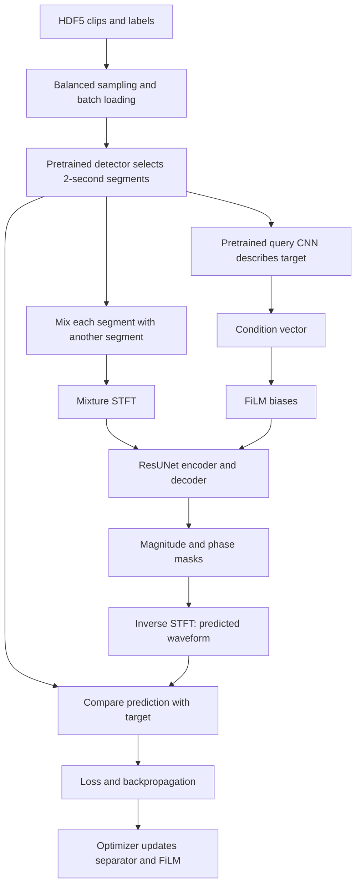

# Understanding USS training, one stage at a time

This guide follows the code in this repository, especially `uss/train.py`, `uss/models/pl_modules.py`, and `uss/models/resunet.py`. You can read sections 1–5 first and return to the detailed CNN tables later. You do not need to understand every layer before understanding the training task.

The worked example uses `scripts/train_configs/ss_model=resunet30,querynet=emb,data=balanced.yaml`: one GPU, 16 examples per batch, mono audio at 32,000 Hz, and 2-second training segments. Shapes below are derived from the code and configuration; they are not measurements from a completed training run.

## 1. What are we teaching the model?

Imagine adding a dog recording to a piano recording. We give the separator:

1. The combined recording, called the **mixture**.
2. A numerical description of the sound we want, called the **condition**.

It predicts the dog recording. During training, we already have the original recording, so we can compare the prediction with that **target** and adjust the model.

In this repository, the target is an audio segment mined from a weakly labelled clip. It may already contain background sounds. A label such as “dog” means that a dog occurs somewhere in the clip; it does not give an isolated dog waveform or exact event boundaries. The training target is therefore the entire selected segment, including whatever sounds it contains.

The separator produces **one requested source per example**. It does not output 527 waveforms at once. The 527 classes describe AudioSet sound categories.

## 2. The framework and where each job lives

| Component | Job | File |
|---|---|---|
| Configuration | Choose data paths, model, batch size, loss, learning rate | `scripts/train_configs/*.yaml` |
| Training entry point | Construct everything and call `trainer.fit(...)` | [train.py](../uss/train.py) |
| Balanced sampler | Choose a sound class, then a clip labelled with that class | [samplers.py](../uss/data/samplers.py) |
| Dataset | Read an audio clip and its labels from HDF5 | [datasets.py](../uss/data/datasets.py) |
| Data module / DataLoader | Assemble batches and distribute them across devices | [datamodules.py](../uss/data/datamodules.py) |
| Anchor detector | Locate a short region containing the chosen sound | [anchor_segment_detectors.py](../uss/data/anchor_segment_detectors.py) |
| Mixer | Add segments to create training mixtures | [anchor_segment_mixers.py](../uss/data/anchor_segment_mixers.py) |
| Query network | Turn the target audio into a condition vector | [query_nets.py](../uss/models/query_nets.py) |
| FiLM | Convert the condition into biases inside the separator | [film.py](../uss/models/film.py) |
| ResUNet | Predict the requested source waveform | [resunet.py](../uss/models/resunet.py) |
| Lightning module | Define one training step and the optimizer | [pl_modules.py](../uss/models/pl_modules.py) |
| Loss | Measure prediction error | [losses.py](../uss/losses.py) |
| Callbacks | Save checkpoints and evaluate separation | [callbacks](../uss/callbacks) |

**PyTorch** provides tensors, layers, and automatic differentiation. An `nn.Module` groups layers and defines a `forward` calculation. Its parameters are the numbers learning can change.

**PyTorch Lightning** runs the training loop around those calculations: moving batches to devices, running backpropagation, stepping the optimizer, and invoking callbacks. Here, `LitSeparation.training_step` returns the loss. You do not see `loss.backward()` there because Lightning handles it under automatic optimization.

**PANNs** supplies pretrained audio networks. There are two separate pretrained models here: a detector used to find segments and a query CNN used to describe them. The ResUNet is a third model, trained for separation.

## 3. How to read a tensor shape

A tensor is a multidimensional array of numbers. Its **shape** gives the length of each axis. Its **dtype** says what kind of number it stores, such as `float32`. Its **device** says where it lives, such as CPU or GPU.

| Symbol | Meaning | Example |
|---|---|---|
| `B` | Batch size on the current device | 16 |
| `L` | Samples in a full audio clip | 320,000 |
| `N` | Samples in a training segment | 64,000 |
| `A` | Audio channels | 1 for mono |
| `D` | Condition vector length | 2,048 for embedding queries |
| `T` | Spectrogram time frames before padding | 201 |
| `Tp` | Time frames after padding | 224 |
| `F` | Frequency bins | 1,025 before cropping |
| `C` | CNN feature channels | 32, 64, 128, etc. |

Samples and frames are different units:

```text
10 seconds × 32,000 samples/second = 320,000 waveform samples
 2 seconds × 32,000 samples/second =  64,000 waveform samples
```

`(16, 1, 64000)` means 16 recordings, each with one audio channel and 64,000 amplitude values. `(16, 32, 224, 1024)` means 16 examples with 32 learned feature maps, each having 224 time positions and 1,024 frequency positions. Those 32 feature channels are learned representations, not 32 microphones or 32 sound classes.

Useful operations in this code:

```python
# x originally has shape (B, N)
x[:, None, :]             # (B, 1, N): insert a singleton channel axis
x.unsqueeze(1)            # same shape change

# x has shape (B, C, T, F)
x.transpose(1, 3)         # (B, F, T, C): exchange axes
torch.cat((x, y), dim=1)  # concatenate feature channels; other axes must match
```

Adding a dimension does not add more recordings. A dictionary such as `input_dict` is only a named container for tensors; it has no single tensor shape itself.

## 4. The complete journey of one batch



If your Markdown viewer does not render Mermaid, follow this sequence: **load → select segment → mix → describe target → separate mixture → compare → update**.

| Stage | Needs | Produces in the worked example |
|---|---|---|
| Load batch | HDF5 waveform data and sampler metadata | `waveform`: `(16, 320000)`; labels: `(16, 527)` |
| Select anchors | Waveforms and one selected `class_id` per clip | Segments: `(16, 64000)` |
| Mix | Segments and `mix_num=2` | Mixtures and targets, each `(16, 64000)` |
| Query | Target segments | Conditions: `(16, 2048)` |
| Prepare separator input | Mixtures and conditions | Mixture: `(16, 1, 64000)`; condition: `(16, 2048)` |
| FiLM | Condition and layer metadata | Many bias tensors, each `(16, C, 1, 1)` |
| STFT | Mixture waveform | Magnitude, cosine, sine: each `(16, 1, 201, 1025)` |
| CNN preparation | Magnitude | After padding/cropping: `(16, 1, 224, 1024)` |
| ResUNet | Prepared magnitude and FiLM biases | Raw mask parameters: `(16, 3, 224, 1024)` |
| Restore shape | Raw mask parameters | `(16, 3, 201, 1025)` |
| Reconstruct audio | Masks plus original magnitude/phase | Predicted waveform: `(16, 1, 64000)` |
| Loss | Prediction and target of matching shape | One scalar tensor: shape `()` |

## 5. What `input_dict` means in your active file

In `LitSeparation.training_step`, the separator input is constructed like this:

```python
conditions = self.query_net(source=segments)['output']

input_dict = {
    'mixture': mixtures[:, None, :],  # (B, 1, N)
    'condition': conditions,         # (B, D)
}

target_dict = {
    'segment': segments[:, None, :], # (B, 1, N)
}

sep_segment = self.ss_model(input_dict)['waveform']
output_dict = {'segment': sep_segment}
loss = self.loss_function(output_dict, target_dict)
```

`ResUNet30.forward` extracts `input_dict['mixture']` and `input_dict['condition']`. It passes the condition through FiLM and the mixture through `ResUNet30_Base` with the generated FiLM data.

Notice the key names: the separator returns **`waveform`**, but the training wrapper puts that tensor under **`segment`** before calling the loss. These are dictionary keys, not two different audio formats.

The mixture and condition must refer to the same examples in the same order. Condition width `D` must match the separator's `condition_size`. The current training wrapper explicitly inserts one audio channel, so its training path is mono even though the model constructor accepts channel counts.

## 6. Loading data and finding a useful segment

### 6.1 HDF5, labels, and balanced sampling

HDF5 is a file format for storing arrays. This pipeline uses two kinds of files:

- **Index HDF5:** `audio_name`, `hdf5_path`, `index_in_hdf5`, and `target`. It tells the sampler which clips have each class and where to find them.
- **Waveform HDF5:** `audio_name`, `waveform`, and `target`. It contains the audio values and clip labels.

The dataset converts stored `int16` waveforms into `float32` by dividing by 32,767. It does not resample audio at loading time. Prepared clips must already have the expected sample rate and compatible lengths.

Each label vector has 527 entries. Multiple entries can be 1 because multiple events can occur in one clip. The sampler chooses one of those classes as `class_id` for anchor detection. It balances class selection over its shuffled class queue; an individual batch does not contain every class.

`collate_fn` stacks examples into arrays and converts float32 arrays to PyTorch tensors. Waveforms and label vectors become tensors; integer class IDs and metadata remain NumPy arrays in this implementation. Some comments in `pl_modules.py` abbreviate waveform shapes as `(batch_size,)`; the actual stacked waveform is `(B, L)`.

### 6.2 Anchor segment detection

The frozen `Cnn14_DecisionLevelMax` returns framewise class scores shaped `(B, detector_frames, 527)`. Its frontend is configured for a 320-sample hop at 32 kHz, or roughly 100 frames per second. Do not confuse detector frames with the separator's padded CNN time axis.

For each example, `max_area` mode:

1. Takes the probability curve for the selected class.
2. Smooths it over `segment_frames = int(2 × 100 + 1) = 201` frames.
3. Finds the highest-scoring position.
4. Clamps that position so the crop stays inside the clip.
5. Crops 100 frames on either side: `200 × 320 = 64000` samples.

This explains why a 201-frame scoring window produces a 64,000-sample waveform crop. Begin and end sample indices are returned for bookkeeping; the next training stages use the cropped waveform.

The detector runs in evaluation mode under `torch.no_grad()`. It supplies training data selection rather than learning from the separation loss.

### 6.3 Mixing creates the supervision

With `mix_num=2`, the mixer uses the next segment in the local batch, wrapping around at the end:

```text
mixture[0] = segment[0] + scaled segment[1]    target[0] = segment[0]
mixture[1] = segment[1] + scaled segment[2]    target[1] = segment[1]
...
mixture[15] = segment[15] + scaled segment[0] target[15] = segment[15]
```

When `match_energy=True`, it scales the added segment using:

```text
energy(x) = mean(x²)
scale = sqrt(energy(target) / max(energy(interferer), 1e-10))
scale is clamped to [0.02, 50]
```

The target itself stays unchanged. The sum is not clipped or divided by two. Each local batch should contain at least `mix_num` examples to avoid reusing the same example within a mixture; a batch size of one with two-source mixing adds the target to itself.

## 7. The query CNN: describing what to extract

The query network receives target segments with shape `(B, N)`. It produces one vector per segment, not one vector per sample.

| Query mode | PANNs output selected | Actual condition shape |
|---|---|---|
| `embedding` | `embedding` | `(B, 2048)` |
| `at_soft` | `clipwise_output` | `(B, 527)` |

An **embedding** is a learned numerical description of audio. Its 2,048 entries are features; they are not 2,048 named classes. `at_soft` uses soft class scores, so its 527 entries correspond to classes. It is not a one-hot label.

`load_pretrained_panns` constructs the PANNs models with a 1,024-sample analysis window, 320-sample hop, and 64 mel bins. A **mel spectrogram** compresses frequency information into perceptually spaced bands. The separator uses a different frontend: a 2,048-sample window and 1,025 linear frequency bins. These networks do not share the same spectrogram representation.

The Cnn14 internals come from the installed `panns_inference.models` dependency, rather than a local CNN implementation in this repository. The input/output contract and frontend settings above are visible in the local code; this guide does not assume uninspected internal layer shapes for that dependency.

For `Cnn14_Wrapper`, `forward_adaptor` just returns the selected PANNs output. Changing `outputs_num` alone does not resize that output; it instead changes the condition width expected by FiLM. Keep these widths consistent.

`AdaptiveCnn14_Wrapper` adds two linear layers: `(B, bottleneck_width) → (B, 2048) → (B, outputs_num)`, with activation and dropout. `YourOwn_QueryNet` is a simple example based on waveform mean, not a developed audio representation.

During training, the target segment also supplies the query. During practical inference, you need an available condition, such as one computed from reference audio; the unknown isolated target is not available for a real mixture. The supplied training evaluator also computes its query from the known target, so that score reflects that particular query setup.

## 8. FiLM: how the query controls the separator

FiLM stands for Feature-wise Linear Modulation. This implementation uses **additive conditioning**:

```text
condition (B, D)
  → a Linear(D, C) layer
  → bias (B, C)
  → bias (B, C, 1, 1)
  → add to normalized features (B, C, T, F)
```

The singleton time and frequency dimensions let PyTorch broadcast each feature-channel bias across the whole spectrogram for that example.

The block applies `BatchNorm(x) + beta`, followed by LeakyReLU and convolution. Although general FiLM can use both scaling and shifting, this code generates `beta1` and `beta2` shifts only. There is no learned condition-dependent `gamma` multiplication here.

`get_film_meta` walks through the separator to find the required channel widths. The result is a nested dictionary matching the block names. Different layers receive different linear projections of the same query vector. The decoder has a dummy `bn2` used for metadata; its corresponding direct `beta2` is generated but not used in the decoder forward calculation.

## 9. From audio samples to a spectrogram

A waveform records amplitude over time. An **STFT** (Short-Time Fourier Transform) examines overlapping windows to describe which frequencies are present at each time position.

The separator uses:

| Setting | Value | Meaning at 32 kHz |
|---|---|---|
| FFT / window size | 2048 | A 64 ms analysis window |
| Hop size | 320 | Move forward 10 ms per frame |
| Window | Hann | Smooth window edges |
| Centering | `True` | Pad the signal around analysis windows |
| Frequency bins | `2048 // 2 + 1 = 1025` | Nonnegative-frequency bins for real audio |

For the standard centered STFT and `N=64000`:

```text
T = floor(N / hop_size) + 1 = 201
F = n_fft // 2 + 1 = 1025
```

`wav_to_spectrogram_phase` processes each audio channel and returns magnitude, phase cosine, and phase sine, each `(B, A, T, F)`. Magnitude measures strength at each time-frequency position. Phase describes oscillation alignment and is needed to reconstruct a waveform.

The CNN sees the magnitude. The original phase values are kept for later reconstruction, and the model predicts a phase adjustment.

Before the CNN:

1. Transpose `(B, A, T, F)` to `(B, F, T, A)`, apply `bn0` with 1,025 frequency features, then transpose back. This first normalization is arranged by frequency bin.
2. Pad time to a multiple of 32: `Tp = ceil(201 / 32) × 32 = 224`.
3. Remove the final frequency bin: `1025 → 1024`.

Time is halved five times; frequency is halved six times. Padding/cropping makes the encoder and decoder sizes line up. For other segment lengths, recompute `T` and `Tp`; do not copy 201 and 224 blindly.

## 10. CNN basics as they appear in this model

A **CNN** is a convolutional neural network. Here it processes a time-frequency grid like an image, with time and frequency as its two spatial axes.

- A **3×3 convolution** learns patterns across nearby time frames and frequency bins. Its filters mix information across input feature channels to produce output channels.
- **Padding of 1** and stride 1 preserve the time/frequency dimensions for these 3×3 convolutions.
- A **1×1 convolution** mixes feature channels without changing time/frequency size. `pre_conv` expands mono magnitude to 32 features; `after_conv` converts 32 features into mask parameters.
- **Batch normalization** normalizes features using batch statistics during training and running statistics during evaluation. It also has learned affine parameters.
- **LeakyReLU** keeps positive values and allows small negative values through, providing a nonlinear transformation.
- **Average pooling** reduces spatial size by averaging neighboring cells. It has no learned weights.
- **Transposed convolution** learns how to upsample a feature map. In this decoder its kernel size equals its stride.
- A **linear layer** maps a vector to another vector using learned weights and biases; FiLM uses these layers.

For example, `pre_conv` has weights shaped `(32, 1, 1, 1)`. A 3×3 convolution from 32 to 64 channels has weights `(64, 32, 3, 3)`. These are parameter shapes, different from activation shapes such as `(B, 64, T, F)`.

### 10.1 Residual connections inside a block

`ConvBlockRes` calculates:

```text
input → BN + beta1 → LeakyReLU → Conv3×3
      → BN + beta2 → LeakyReLU → Conv3×3 → x
output = shortcut(input) + x
```

If channel counts match, the shortcut is the input itself. If they differ, a learned 1×1 convolution adjusts the input's channels. Addition requires matching shapes. This provides a direct path for information and gradients through the block.

### 10.2 U-Net skip connections between encoder and decoder

The encoder compresses the grid into a smaller representation. The decoder expands it back. U-Net preserves encoder features and sends them to matching decoder stages so fine detail can be reused.

These skips use **concatenation** along channels. For instance, `(B, 384, 7, 32)` concatenated with `(B, 384, 7, 32)` becomes `(B, 768, 7, 32)`. The next residual block reduces it to 384 channels.

Residual addition within a block and U-Net concatenation between blocks are two distinct operations.

## 11. Every ResUNet stage and its shape

Use `B=16` for the example, but keep `B` symbolic in the tables. CNN input is `(B, 1, 224, 1024)`.

### 11.1 Encoder and bottleneck

Each encoder returns `encoder_pool, encoder`. The second value is the **feature before pooling**, saved for a decoder skip.

| Code variable / stage | Saved feature before pooling | Output passed to next stage |
|---|---|---|
| `pre_conv` | — | `(B, 32, 224, 1024)` |
| Encoder 1: `x1` | `(B, 32, 224, 1024)` | `x1_pool`: `(B, 32, 112, 512)` |
| Encoder 2: `x2` | `(B, 64, 112, 512)` | `x2_pool`: `(B, 64, 56, 256)` |
| Encoder 3: `x3` | `(B, 128, 56, 256)` | `x3_pool`: `(B, 128, 28, 128)` |
| Encoder 4: `x4` | `(B, 256, 28, 128)` | `x4_pool`: `(B, 256, 14, 64)` |
| Encoder 5: `x5` | `(B, 384, 14, 64)` | `x5_pool`: `(B, 384, 7, 32)` |
| Encoder 6: `x6` | `(B, 384, 7, 32)` | `x6_pool`: `(B, 384, 7, 16)` |
| `conv_block7a` | Not used as a skip | `x_center`: `(B, 384, 7, 16)` |

Encoders 1–5 pool by `(2, 2)`. Encoder 6 pools by `(1, 2)`, reducing frequency only. The center block uses `(1, 1)` pooling, so its spatial size stays the same.

The encoder reduces spatial resolution while generally increasing feature channels. It learns a representation used to estimate source masks, rather than directly assigning a named sound class to each channel.

### 11.2 Decoder

Each decoder normalizes and conditions its input, upsamples, concatenates the saved encoder feature, and runs a residual convolution block.

| Stage | After upsampling | Skip | After concatenation | Output |
|---|---|---|---|---|
| Decoder 1: `x7` | `(B, 384, 7, 32)` | `x6` | `(B, 768, 7, 32)` | `(B, 384, 7, 32)` |
| Decoder 2: `x8` | `(B, 384, 14, 64)` | `x5` | `(B, 768, 14, 64)` | `(B, 384, 14, 64)` |
| Decoder 3: `x9` | `(B, 256, 28, 128)` | `x4` | `(B, 512, 28, 128)` | `(B, 256, 28, 128)` |
| Decoder 4: `x10` | `(B, 128, 56, 256)` | `x3` | `(B, 256, 56, 256)` | `(B, 128, 56, 256)` |
| Decoder 5: `x11` | `(B, 64, 112, 512)` | `x2` | `(B, 128, 112, 512)` | `(B, 64, 112, 512)` |
| Decoder 6: `x12` | `(B, 32, 224, 1024)` | `x1` | `(B, 64, 224, 1024)` | `(B, 32, 224, 1024)` |
| `after_conv` | — | — | — | `(B, 3, 224, 1024)` for mono |

Decoder 1 upsamples by `(1, 2)`; the others use `(2, 2)`. In general, `after_conv` produces `3 × output_channels` feature channels. For mono, the three channels represent mask parameters, not three separated sources.

## 12. Turning CNN output back into audio

`ResUNet30_Base.forward` first restores dimensions:

```text
(B, 3, 224, 1024)
  → pad one frequency bin: (B, 3, 224, 1025)
  → remove extra time frames: (B, 3, 201, 1025)
```

The restored last frequency column contains zero raw mask parameters; it is not a newly predicted column. A zero magnitude logit becomes 0.5 after sigmoid.

`feature_maps_to_wav` groups the feature channels as `(B, output_channels, 3, T, F)`. It calculates:

1. **Magnitude mask:** `sigmoid` gives values between 0 and 1.
2. **Phase parameters:** `tanh` produces real and imaginary mask components; `magphase` converts them into cosine and sine.
3. **Output magnitude:** multiply the mixture magnitude by the magnitude mask.
4. **Output phase:** combine mixture phase with the predicted phase adjustment using sine/cosine angle-addition formulas.
5. **Complex output:** reconstruct real and imaginary spectrogram components.
6. **Inverse STFT:** convert those components into a waveform, requesting the original `audio_length=N`.

```text
out_real, out_imag: (B, A, T, F)
ISTFT input:       (B × A, 1, T, F)
ISTFT output:      (B × A, N)
final waveform:   (B, A, N)
```

STFT and inverse STFT parameters are frozen, but their operations still allow gradients to pass through the separator's predicted masks. “Frozen transform parameters” does not mean that the reconstruction cuts off backpropagation.

## 13. Loss, gradients, and what actually learns

The selected configuration uses waveform L1 loss:

```text
prediction: (B, 1, N)
target:     (B, 1, N)
loss = mean(abs(prediction - target))
```

The mean covers batch, channel, and sample axes. A scalar loss has no remaining axes: shape `()`. Smaller loss means smaller average sample-wise error, although listening and evaluation metrics are still useful for assessing separation quality.

The optional `l1_wav_l1_sp` adds magnitude-spectrogram L1 loss to waveform L1. There is no extra weighting or normalization between these terms in this implementation, so they can have different numerical scales.

Conceptually, an update is:

```text
forward calculation → loss → gradients → AdamW parameter update
```

A **gradient** measures how the loss changes when a parameter changes. Backpropagation calculates those gradients through the computation graph. The optimizer uses them to change weights; it does not alter the target recording.

| Component | Updated by the current optimizer? | Reason |
|---|---|---|
| ResUNet convolutions and normalization affine parameters | Yes | Included in `self.ss_model.parameters()` |
| FiLM linear layers | Yes, where used in the loss path | Part of `ResUNet30` |
| STFT / inverse STFT transform parameters | No | Frozen |
| Anchor detector | No | Frozen and used under `no_grad` |
| Default frozen query CNN | No | Frozen and used under `no_grad` |
| Optional query adaptor or unfrozen query base | No optimizer updates in this implementation | Optimizer only receives separator parameters |

That last row matters if you later modify the model: setting `freeze_base=False` or `freeze_adaptor=False` does not by itself add query parameters to the optimizer. They may receive gradients without being updated. Joint query training would require an explicit optimizer change.

BatchNorm running statistics are buffers rather than ordinary gradient-trained parameters. They update during training mode. `model.eval()` changes behavior such as BatchNorm and dropout; `torch.no_grad()` controls gradient tracking. They serve different purposes.

## 14. Steps, epochs, learning rate, and evaluation

A **training step** processes one batch and, with the current default optimization setup, performs one optimizer update. A **batch** holds multiple examples. An **epoch** conventionally means a pass over a dataset, but this repository uses an indefinitely yielding sampler whose reported length is `steps_per_epoch`. Its epochs are not guaranteed single passes through all clips.

The example configuration reports 10,000 steps per epoch. `Trainer` has `max_epochs=-1`, no explicit `max_steps`, and no early-stop callback. The YAML's `early_stop_steps` is not used by `train.py`; do not expect it to stop the run. A deliberately bounded run requires a trainer limit in code, such as `max_steps`, or manually stopping training.

### 14.1 Learning rate

The base learning rate is `1e-3`. With `constant_warm_up` and `warm_up_steps=10000`, the scheduler function returns:

| Scheduler step | Multiplier | Learning rate |
|---|---|---|
| 0–9,999 | 0.001 | `1e-6` |
| 10,000–19,999 | 0.01 | `1e-5` |
| 20,000–29,999 | 0.1 | `1e-4` |
| 30,000 onward | 1 | `1e-3` |

This is a staged warmup. `reduce_lr_steps` is accepted but unused by this scheduler. The alternative `linear_warm_up` increases the multiplier linearly during warmup and then uses `0.9 ** (step // reduce_lr_steps)`.

The optimizer is AdamW with `weight_decay=0.0`, so this configuration applies no weight decay despite the optimizer name. The scheduler is stepped at training-step intervals.

### 14.2 Checkpoints and metrics

The custom checkpoint callback saves at global step 1 and every `save_step_frequency` steps. Files are named `steps=<number>.ckpt`. Set `resume_checkpoint_path` to an existing checkpoint to resume via `trainer.fit(..., ckpt_path=...)`.

The evaluation callback also runs at step 1, then every `evaluate_step_frequency` steps. Evaluation data must therefore be prepared before the first training batch completes, even if the configured interval is large.

Evaluation loads paired `...,source.wav` and `...,mixture.wav` files from `class_id=<number>` directories. It measures **SDRi**, the improvement in signal-to-distortion ratio over using the mixture as the estimate. Higher means improvement under this metric; negative means worse than the mixture baseline. The callback takes the median within each class and then averages class medians.

Outputs are placed under the training workspace in `checkpoints`, `logs`, `tf_logs`, and `statistics`. TensorBoard receives `SDRi/balanced_train` and `SDRi/test`. `training_step` currently does not call `self.log` for training loss, so do not expect a training-loss TensorBoard curve from this code alone.

## 15. What needs to exist before starting training?

This is a preparation checklist, not a claim that your environment or datasets have already been validated.

1. A Python environment containing PyTorch, Lightning, torchlibrosa, PANNs inference, and the other imported dependencies. Inspect `requirements.txt` and `setup.py`; the current requirements file comments out the Lightning version line.
2. Prepared mono 32 kHz clips, normally 10 seconds long, in waveform HDF5 files.
3. A matching index HDF5 whose stored waveform paths exist on your machine. Moving a dataset can leave stale paths inside its index file.
4. At least one available labelled training clip for every class sampled by `BalancedSampler`. Empty class lists cause indexing failures.
5. Pretrained Cnn14 query and Cnn14_DecisionLevelMax detector checkpoints, plus class metadata. `get_path` can download missing cached files; importing `uss.config` may trigger metadata retrieval.
6. Prepared evaluation mixture/source pairs for the configured evaluation directories and classes.
7. A configuration with matching query output width and separator condition width.
8. A usable GPU for the current unmodified training entry point, plus sufficient memory.

The repository's existing data preparation scripts are under `scripts/1_create_train_data` and `scripts/2_create_evaluation_data`. They are Bash scripts and need their dataset/workspace paths checked before use on Windows. This guide does not download data or launch training.

From PowerShell, run the module from the repository directory, after preparing those prerequisites:

```powershell
Set-Location C:\Users\zmak002\Documents\FYP\uss
python -m uss.train --workspace .\workspaces\uss --config_yaml '.\scripts\train_configs\ss_model=resunet30,querynet=emb,data=balanced.yaml'
```

Here `--workspace` is the data/output directory, not necessarily the source-code directory. Relative dataset and evaluation paths in YAML are joined to this training workspace.

For a small initial debugging run, reduce `num_workers` to 0 to simplify data-loading errors and choose a local batch size that still supports mixing. A short run also needs an explicit trainer step limit; changing `steps_per_epoch` alone does not establish a total training limit.

## 16. Repository details that can otherwise be confusing

These observations describe the inspected source; they are not changes made to the training program.

| Detail | Actual behavior |
|---|---|
| README and `scripts/3_train.sh` configuration path | Some commands use `scripts/train/...`; the files present here are under `scripts/train_configs/...` |
| CPU device count | `get_datamodule` multiplies batch size by `torch.cuda.device_count()`. With no GPU this becomes zero, so `accelerator="auto"` alone does not make this training path CPU-ready |
| YAML `precision` | Trainer hardcodes `precision="32-true"` |
| YAML `early_stop_steps` | Not wired into the trainer |
| YAML `random_seed` | Not read by `train.py`; sampler uses its default seed of 1234, without globally seeding all training randomness |
| YAML `sampler_type` | `get_datamodule` constructs `BalancedSampler` directly |
| YAML `frames_per_second` | Training uses the constant `FRAMES_PER_SECOND` imported from `uss.config` |
| YAML detector `freeze` | Detector is loaded with `freeze=True` directly |
| YAML `freeze_adaptor` with plain `Cnn14_Wrapper` | This wrapper has no learned adaptor |
| Setting a new sample rate in YAML | PANNs loading is hardcoded to 32 kHz; dataset loading does not resample. A new rate requires coordinated code/data changes |
| Docstring in `Base.wav_to_spectrogram_phase` | It describes an input channel axis in the wrong position; implementation uses `(B, A, N)` |

For multiple GPUs, the sampler constructs a global batch of `batch_size_per_device × GPU_count` and its distributed wrapper splits examples among ranks. In the shape tables, `B` is the batch received by one rank. Anchor mixing happens within that local batch.

## 17. How to inspect shapes without getting lost

Place a breakpoint in `LitSeparation.training_step`, then inspect these variables in order:

```text
batch_data_dict['waveform']  → (B, L)
segments_dict['waveform']    → (B, N)
mixtures                    → (B, N)
segments                    → (B, N)
conditions                  → (B, D)
input_dict['mixture']        → (B, 1, N)
sep_segment                 → (B, 1, N)
loss                        → ()
```

Next, step into `ResUNet30_Base.forward` and inspect `mag`, `x` after padding/cropping, `x1_pool` through `x6_pool`, `x_center`, and `x7` through `x12` using section 11.

A temporary diagnostic line can show shape, type, and location without printing all audio values:

```python
print('mixture:', mixtures.shape, mixtures.dtype, mixtures.device)
```

Useful checks immediately before separation/loss are:

```python
assert input_dict['mixture'].ndim == 3
assert conditions.ndim == 2
assert conditions.shape[0] == mixtures.shape[0]
assert conditions.shape[1] == self.ss_model.film.condition_size
assert sep_segment.shape == target_dict['segment'].shape
assert torch.isfinite(loss).item()
```

Matching shapes matter because PyTorch can silently broadcast some mismatches. Remove diagnostic prints after checking a batch, especially during distributed training.

| Symptom | First thing to inspect |
|---|---|
| Linear-layer multiplication shape error | Query width versus FiLM `condition_size` |
| Conv2d receives the wrong rank | Missing `(B, 1, N)` channel axis or incorrect tensor at the model boundary |
| Decoder concatenation size error | Time padding, frequency cropping, pooling, and corresponding skip dimensions |
| HDF5 file not found | Workspace path and paths stored inside the index HDF5 |
| Stacking segments fails | Clip lengths, sample rate, and actual crop lengths |
| Failure after the first update | Step-1 checkpoint/evaluation callbacks and evaluation files |
| GPU out of memory | Local batch size, segment length, and large intermediate CNN feature maps |
| No training-loss curve | Missing `self.log` call for the loss |
| NaN or infinite loss | Audio values, prediction values, loss inputs, and gradients |

## 18. A manageable reading order

1. Read `LitSeparation.training_step`. Identify the mixture, query condition, prediction, and target.
2. Read the small `ResUNet30.forward` wrapper. Follow the two branches: condition to FiLM, mixture to the base model.
3. Read `ResUNet30_Base.forward` with the shape tables beside it.
4. Read `ConvBlockRes` and one decoder block. Understand addition versus concatenation.
5. Read `feature_maps_to_wav` once the CNN journey makes sense.
6. Return to data loading, the detector, optimizer, and callbacks when you need to run or modify training.

You can explain the core training step in one sentence: **select a target segment, mix it with another segment, describe the target with a query vector, predict it from the mixture, and update the separator using the prediction error.**
